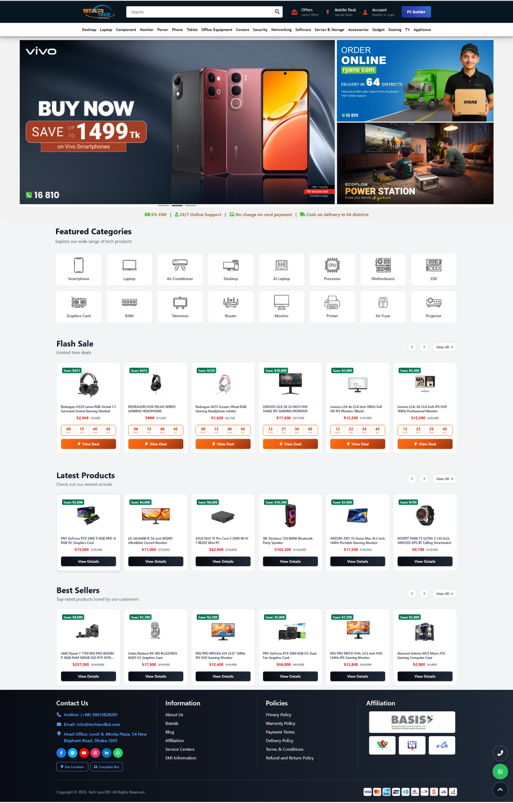

<h1 align="center">🛒 GadGet</h1>

<p align="center">
  <b>A modern gadget e-commerce store for Bangladesh, built with Laravel 13 and Filament 5.</b><br>
  Phones, laptops, PC parts and accessories, plus a PC Builder, flash sales and local payment methods.
</p>

<p align="center">
  
  
  
  
  
</p>

<p align="center">
  
</p>

---

## ✨ Features

### 🛍️ Storefront

- **Dynamic homepage**: hero sliders, banners and product sections, all managed from the admin panel
- **Category browsing** with filters for brand, price, specifications and stock status
- **Product pages** with variants (color, storage, RAM…), specification tables and image galleries
- **Live search** with instant suggestions as you type
- **🖥️ PC Builder**: pick a CPU, motherboard, RAM, GPU and other parts to build a complete PC
- **Offers, flash sales and mobile deals** with countdowns and special pricing
- **Cart and checkout** with district-based shipping rates
- **Local payment methods**: Cash on Delivery, bKash, Nagad and bank transfer
- **CMS pages** such as About, Privacy Policy and Terms
- **Meta Pixel** integration for marketing

### ⚙️ Admin Panel (Filament)

- **Dashboard** with revenue, orders by status, top-selling products, stock status and category charts
- **Catalog management**: products, variants, categories, brands, attributes and specifications
- **Content management**: banners, home sections, menus, pages and service highlights
- **Marketing**: offers and flash sales
- **Site settings**: store information, contact details and more, edited from the UI
- **Cache manager**: clear caches with one click
- **Role-based access** with six staff roles (Super Admin, Admin, Manager, Product Manager, Order Manager, Content Manager)
- **Activity log** and **inventory transaction** history

---

## 🧰 Tech Stack

| Layer | Technology |
|---|---|
| Backend | Laravel 13, PHP 8.3+ |
| Admin panel | Filament 5 |
| Auth | Laravel Fortify |
| Search | Laravel Scout (database driver) |
| Permissions | spatie/laravel-permission |
| Media | spatie/laravel-medialibrary |
| Audit log | spatie/laravel-activitylog |
| Frontend | Blade, Tailwind CSS 4, Vite |
| Animation & UI | GSAP, Swiper, Lenis, AutoAnimate, dotLottie |
| Database | MariaDB / MySQL |

---

## 🚀 Getting Started

### Requirements

- PHP **8.3+** with `intl`, `gd`, `pdo_mysql`, `zip`, `bcmath`, `fileinfo` and `exif`
- Composer 2
- Node.js 20+ and npm
- MariaDB 10.4+ or MySQL 8+

### Installation

```bash
# 1. Clone the repository
git clone https://github.com/SourovKarmokar/GadGet.git
cd GadGet

# 2. Install dependencies
composer install
npm install

# 3. Set up the environment
cp .env.example .env
php artisan key:generate
```

Open `.env` and set your database details, plus the first admin account:

```env
DB_DATABASE=gadget_demo
DB_USERNAME=root
DB_PASSWORD=

ADMIN_EMAIL=admin@example.com
ADMIN_PASSWORD=your-secure-password
```

```bash
# 4. Create the tables and load demo data
php artisan migrate --seed

# 5. Link storage and build assets
php artisan storage:link
npm run build

# 6. Start the server
composer run dev
```

Now open:

- 🛍️ **Store**: http://localhost:8000
- ⚙️ **Admin panel**: http://localhost:8000/admin

> 💡 If you leave `ADMIN_PASSWORD` empty, the seeder generates a random password and prints it once in the terminal. Change it after your first login.

> 🗄️ To run the site with the real data instead of demo data (database dump + uploaded images), follow [DATABASE.md](DATABASE.md).

---

## 📁 Project Structure

```
app/
├── Enums/          # Order status, payment method, staff roles…
├── Filament/       # Admin panel resources, pages and dashboard widgets
├── Http/Controllers/Store/   # Storefront controllers
├── Models/         # Eloquent models
├── Observers/      # Cache invalidation on catalog changes
├── Policies/       # Role-based authorization
└── Services/       # Cart, checkout, inventory, PC Builder, filters, reports
database/
├── migrations/
└── seeders/        # Roles, catalog, shipping, demo content
resources/views/    # Blade templates for the storefront
```

---

## 🧪 Testing

```bash
composer run test
```

Format the code with Laravel Pint:

```bash
vendor/bin/pint
```

---

## 📄 License

This project is open-source software licensed under the [MIT license](https://opensource.org/licenses/MIT).

<p align="center">Made with ❤️ in Bangladesh</p>
